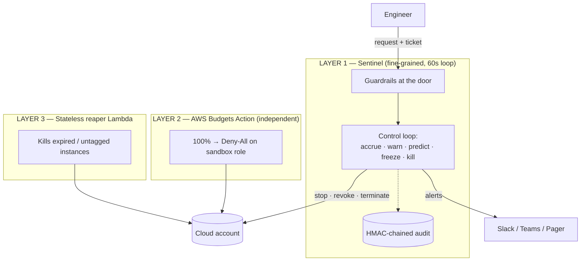
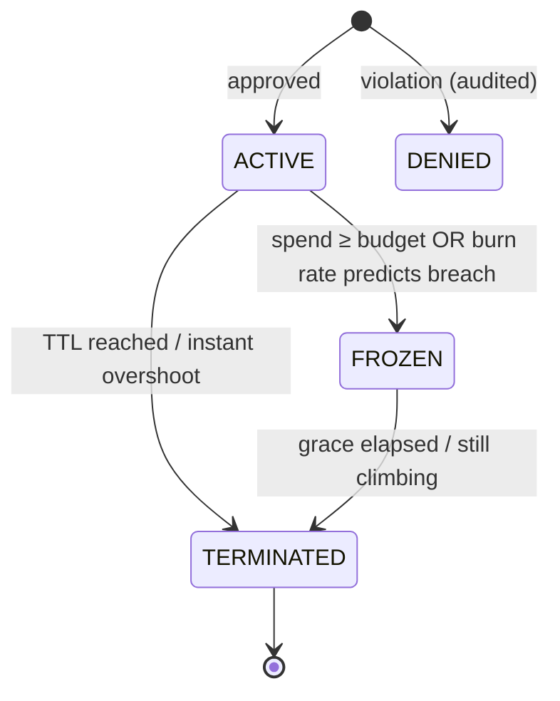
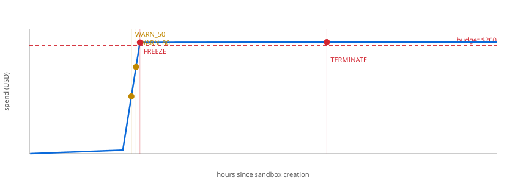

# 🛡️ Sandbox Sentinel

**Guardrails, auto-expiry and a budget kill-switch for cloud sandboxes** — built for organizations where an
unattended GPU cluster, a forgotten database, or a leaked key is a board-level event: banks, federal agencies,
parastatals, Fortune 500 engineering and data-science estates.

> Zero dependencies. Runs in 5 seconds. Every claim below is backed by a test or by the demo you can run yourself.

```bash
git clone <this-repo> && cd sandbox-sentinel
make test     # 21 tests
make demo     # simulates 10 hours in 1 second, writes demo-report.html
```

## The problem (in executive terms)

| Failure | Typical cost | What Sentinel does |
|---|---|---|
| Notebook loops on a paid API / egress overnight | $10k–$500k | Predicts the breach, **freezes** compute, **revokes** credentials |
| "Temporary" sandbox lives for 14 months | Spend + audit finding | Hard TTL; terminated on expiry, with T-60/T-10 min notices |
| Engineer self-approves more time or budget | SoD violation | Four-eyes extension, capped count and length |
| Shadow resource launched outside the pipeline | Invisible spend | Tag discovery; unpriced = billed at a *conservative* rate; Layer 3 reaps untagged |
| "Prove the control worked" | Audit scramble | HMAC-chained log: `sentinel verify`; tamper → exit code 2 |

## How it works — three independent layers



Layers 2 and 3 **do not depend on Sentinel's code, database or host.** More diagrams (lifecycle state machine,
runaway sequence diagram, tick decision tree): [`docs/architecture.md`](docs/architecture.md).



## Real output from `make demo`

A runaway notebook starts burning ~$9/min two hours in. Alice's budget is **$200**.



```
  [WARNING ] 50% of $200 budget consumed          t+131m
  [WARNING ] 80% of $200 budget consumed          t+137m
  [CRITICAL] FROZEN (BUDGET_EXCEEDED): spend $205.70 >= budget $200.00.
             Compute stopped, credentials revoked.   t+142m
  ... nobody responds ...
  [INFO    ] TERMINATED (FROZEN_TIMEOUT)          t+382m

  sandbox       owner   budget    spend  state       reason
  sbx-…         bob        $60    $0.08  TERMINATED  EXPIRED
  sbx-…         carol     $120    $2.52  TERMINATED  EXPIRED
  sbx-…         alice     $200  $206.35  TERMINATED  FROZEN_TIMEOUT
  audit chain: VERIFIED (23 records)
```

Without Sentinel the loop would have run all night. With it, the loss is capped at **~3% over budget** — and that
overshoot is honest: a 60-second loop can't stop what happens inside the minute (see *Known limits*).

## Try it by hand

```bash
export SENTINEL_HOME=/tmp/sentinel
python -m sentinel request alice CC-ML 100 --ttl 4
python -m sentinel provision sbx-XXXX m5.xlarge
python -m sentinel inject sbx-XXXX 120          # simulate runaway usage
python -m sentinel tick                          # → TERMINATED (BUDGET_HARD_KILL)
python -m sentinel status
python -m sentinel verify                        # audit chain integrity
python -m sentinel --policy policies/bank-strict.json request bob CC-2 100   # DENIED: change ticket required
python -m sentinel daemon                        # run the control loop for real
```

## Policy packs

| File | Intent |
|---|---|
| `policies/default.json` | Sensible engineering default: 8h TTL, $500 cap |
| `policies/bank-strict.json` | EU-only, ticket mandatory, 1 sandbox/person, 95% freeze, 1 extension |
| `policies/federal-fedramp.json` | GovCloud regions only, ticket mandatory, tight type allow-list |

Unknown policy keys are **rejected** (a typo must not silently weaken a control).

## Going live on AWS

1. `terraform/aws` — Layer 2 (Budgets Action → Deny-All) and Layer 3 (reaper Lambda, **starts in dry-run**).
2. `pip install boto3` then `python -m sentinel --provider aws daemon`. Resources are created by your IaC with tag
   `sentinel:sandbox=<id>` and `sentinel:expires=<ISO8601>`; Sentinel discovers, prices and governs them.
3. Set `SENTINEL_AUDIT_KEY` from your vault and `SENTINEL_WEBHOOK` for Slack/Teams.
4. Rollout plan in [`docs/runbook.md`](docs/runbook.md).

> **Honesty box.** The sim provider, engine, audit chain and reaper logic are fully tested. The AWS provider and
> Terraform are written to the documented APIs but have **not** been run against a live account — apply to a
> throwaway account first. Azure/GCP: implement the six methods in `providers/base.py`.

## Known limits (say these to your board before they ask)

- 60-second loop ⇒ possible overshoot of `rate × 60s`. Mitigated by `predictive_horizon_ticks`, Layer 2, and the
  worst-case pre-flight check that refuses resources that can't fit in budget over the TTL.
- AWS Budgets data lags hours; it is a backstop, not the primary.
- Usage-based services (LLM tokens, egress) need metering via `Provider.drain_usage`.
- SQLite ledger is single-node; for HA run Sentinel behind leader election or swap `Ledger` for Postgres/DynamoDB.

## Repo map

```
sentinel/engine.py      guardrails + control loop (the heart; ~150 lines)
sentinel/audit.py       HMAC-chained tamper-evident log
sentinel/providers/     sim (tested) · aws (tag-driven) · base interface
sentinel/report.py      zero-dependency HTML/SVG executive report
lambda/reaper.py        stateless Layer-3 backstop
terraform/aws/          Layer 2 + 3 infrastructure
policies/               bank · federal · default
docs/                   architecture (4 diagrams) · controls mapping · runbook · exec brief
tests/                  21 tests: guardrails, kill-switch, audit tamper, reaper
```

## Controls mapping

NIST 800-53 / SOX ITGC / DORA / FedRAMP starting-point table: [`docs/controls-mapping.md`](docs/controls-mapping.md).
This is a mapping aid for your GRC team, not a compliance attestation.

MIT licensed.
