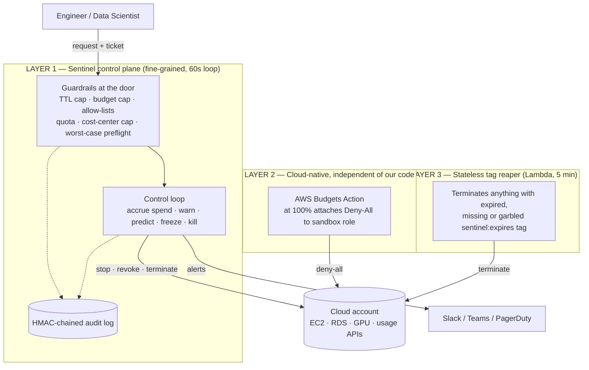
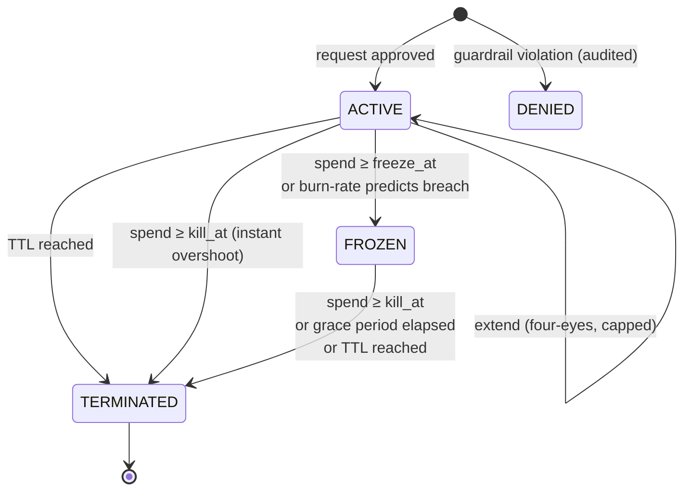
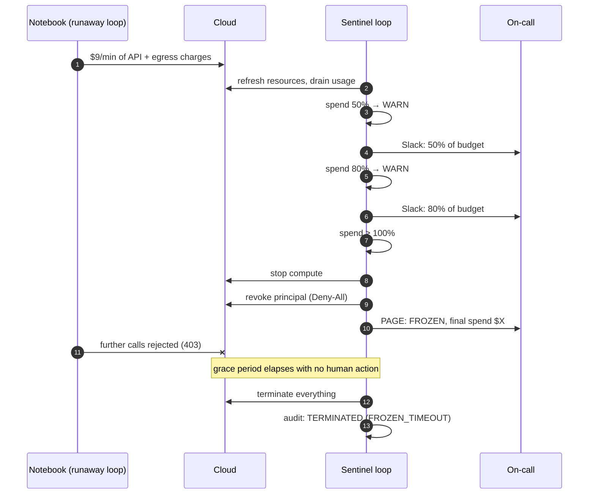
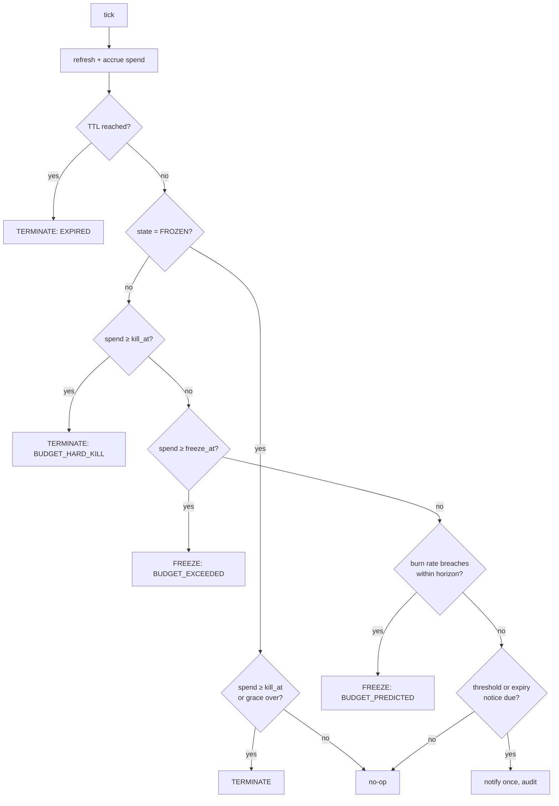

# Architecture

## 1. Defense in depth — three independent layers

If one layer fails, the next still contains the loss. Layers 2 and 3 do **not** depend on Sentinel's code, database or host.

## 2. Sandbox lifecycle

`FROZEN` = compute stopped **and** credentials revoked. A frozen sandbox cannot spend more, but its data survives for `frozen_grace_hours` so work is recoverable by a human with approval.

## 3. Runaway scenario — what happens minute by minute

## 4. Decision order inside one tick

